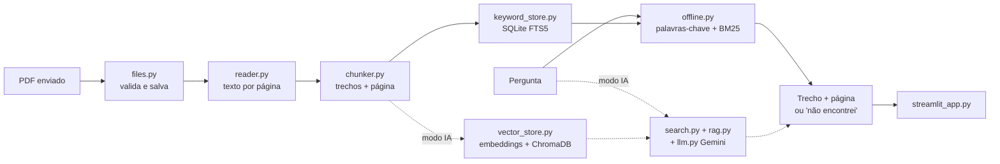

# AI Document Assistant

🇧🇷 Português · [🇺🇸 English](#english)

Aplicativo web para **fazer perguntas sobre documentos PDF** e ver exatamente **de qual arquivo e página** vem cada resposta.

Funciona em dois modos:

| | **Sem IA** (padrão) | **Com IA** (opcional) |
|---|---|---|
| Como busca | palavras-chave (SQLite FTS5, ranking BM25) | busca semântica (embeddings + ChromaDB) |
| Resposta | a frase do documento que mais combina, com destaque | texto em linguagem natural gerado pelo Gemini, com citações |
| Precisa de | Python, `pypdf` e `streamlit` | chave do Gemini, internet e os pacotes de `requirements-ia.txt` |
| Funciona offline | ✅ | ❌ |
| Entende sinônimos | ❌ (só as palavras e variações próximas) | ✅ |

Nos dois modos, quando não há evidência suficiente, o app diz que **não encontrou** em vez de inventar.

> Projeto de portfólio, em desenvolvimento. Uso local e individual: não há login nem separação entre usuários (veja [Limitações](#limitações-e-privacidade)).

## Recursos

- Upload de PDFs pela interface (valida tipo, tamanho e conteúdo; recusa arquivos inválidos, protegidos por senha ou escaneados).
- Texto extraído **página por página**, preservando o número da página.
- Trechos (*chunks*) com sobreposição, sem atravessar páginas.
- Busca que ignora acentos e maiúsculas e casa variações da palavra (devolução, devolver, devolvido).
- Duplicados detectados por hash (mesmo arquivo, ou o mesmo conteúdo com outro nome) e atualização de arquivos reenviados; gravação "tudo ou nada".
- Fontes com arquivo, página e trecho destacado; remoção de documentos pela interface.
- Modo com IA: se nenhum trecho for parecido o bastante, **o modelo nem é chamado**; o prompt manda citar fontes e ignorar instruções escondidas nos documentos.

## Arquitetura



```
app/
  config.py         configurações (caminhos, limites)
  reader.py         extrai o texto de cada página do PDF
  chunker.py        divide o texto em trechos, com sobreposição
  files.py          validação e gravação segura dos uploads
  keywords.py       palavras-chave, destaque e recorte (sem IA)
  keyword_store.py  banco SQLite com busca de texto (sem IA)
  offline.py        responder sem IA
  vector_store.py   embeddings + ChromaDB (modo IA)
  search.py         busca semântica (modo IA)
  llm.py            prompt e chamada ao Gemini (modo IA)
  rag.py            fluxo completo do modo IA
  ask.py            perguntas pelo terminal
  calibrar.py       ajuda a escolher o limite de distância (modo IA)
streamlit_app.py    interface web
tests/              testes automatizados
```

## Instalação (Windows / PowerShell)

Requer Python 3.10 ou mais novo.

```powershell
git clone <url-do-repositorio>
cd ai-document-assistant
python -m venv .venv
.\.venv\Scripts\Activate.ps1
python -m pip install -r requirements.txt
```

Isso já basta para o **modo sem IA** (instalação leve, sem baixar modelos).

### Modo com IA (opcional)

```powershell
python -m pip install -r requirements-ia.txt
```

Copie `.env.example` para `.env` e coloque a sua chave:

```env
GEMINI_API_KEY=sua_chave_aqui
```

O `.env` está no `.gitignore`. **Nunca publique a sua chave.**

## Uso

```powershell
python -m streamlit run streamlit_app.py
```

Envie PDFs na barra lateral e pergunte. O interruptor "Usar IA (Gemini)" liga o modo com IA. Pelo terminal:

```powershell
python -m app.keyword_store                              # indexa os PDFs da pasta documents\ (sem IA)
python -m app.ask "Qual é o prazo de devolução?"         # sem IA; --trechos mostra o texto das fontes
python -m app.ask "Qual é o prazo?" --ia                 # com IA (precisa do modo IA instalado)
```

Dica: no modo sem IA, escreva a pergunta com as palavras que aparecem no documento ("prazo de devolução"). O limite de cobertura (`MIN_COVERAGE` em `app/config.py`) define quantos termos da pergunta o trecho precisa conter.

### Ajustando o limite do modo com IA

```powershell
python -m app.calibrar "uma pergunta COM resposta" "uma pergunta SEM resposta"
$env:RAG_MAX_DISTANCE = "1.1"    # testa outro limite sem editar o código
```

## Testes

```powershell
python -m pip install -r requirements-dev.txt
python -m pytest -v
```

Cobrem leitura de PDF, divisão em trechos, os dois bancos (duplicados, atualização, remoção), busca, resposta sem IA, fluxo do modo IA e validação de uploads. O modo sem IA é testado com SQLite de verdade. No modo IA, o banco vetorial, o modelo de embeddings e o Gemini são **simulados**, então rodam em segundos e sem gastar cota; a integração real deve ser conferida localmente com um documento de teste.

## Limitações e privacidade

- **Sem autenticação e sem isolamento entre usuários:** todos os documentos ficam na mesma base. Não use como serviço multiusuário sem acrescentar login, bases por usuário e limites de uso.
- **Modo sem IA:** não entende sinônimos nem reescreve respostas; funciona melhor com perguntas que usam as palavras do documento.
- **Modo com IA:** a pergunta e os trechos recuperados são enviados à API do Gemini. Não use documentos confidenciais sem conferir os termos do serviço. O modelo de embeddings (`all-MiniLM-L6-v2`) é voltado ao inglês; para português, um modelo multilíngue tende a recuperar melhor (trocar exige reindexar). Respostas de IA podem conter erros: confira as fontes.
- PDFs escaneados (só imagens) não são lidos: não há OCR.
- Os trechos não atravessam páginas, então uma frase dividida entre duas páginas pode ser cortada.
- `data/`, `chroma_db/`, `documents/*.pdf` e o `.env` ficam locais e **não** devem ir para o GitHub (já estão no `.gitignore`).

## Publicação

Para uma demonstração pública, use apenas documentos de exemplo sem dados pessoais, guarde chaves nos *secrets* da plataforma (nunca no repositório) e lembre que, sem login, qualquer visitante poderia enviar arquivos e, no modo IA, consumir a sua cota de API. Discos de plataformas gratuitas costumam ser temporários: `data/` e `chroma_db/` podem ser apagados a cada reinício. O modo sem IA é o mais indicado para uma demonstração: não gasta cota e não envia nada a terceiros.

---

<a id="english"></a>

# AI Document Assistant (English)

A web app to **ask questions about PDF documents** and see exactly **which file and page** each answer comes from.

It has two modes:

| | **No AI** (default) | **With AI** (optional) |
|---|---|---|
| Search | keywords (SQLite FTS5, BM25 ranking) | semantic search (embeddings + ChromaDB) |
| Answer | the document sentence that best matches, highlighted | natural-language text from Gemini, with citations |
| Needs | Python, `pypdf`, `streamlit` | Gemini API key, internet, packages in `requirements-ia.txt` |
| Works offline | ✅ | ❌ |
| Understands synonyms | ❌ (only the words and close variants) | ✅ |

In both modes, when there is not enough evidence, the app says it **could not find** the answer instead of making one up.

> Portfolio project, work in progress. Local, single-user use only: no login and no separation between users (see [Limitations](#limitations-and-privacy)).

## Features

- PDF upload from the UI (validates type, size and content; rejects invalid, password-protected or scanned files).
- Page-by-page extraction keeping page numbers; overlapping chunks that never cross pages.
- Accent- and case-insensitive search that matches word variants.
- Duplicate detection by hash, updates for re-uploaded files, all-or-nothing writes.
- Sources with file, page and highlighted excerpt; document removal from the UI.
- AI mode: if no passage is close enough, **the model is not even called**; the prompt requires citations and tells the model to ignore instructions hidden in documents.

## Setup (Windows / PowerShell)

Requires Python 3.10+.

```powershell
git clone <repository-url>
cd ai-document-assistant
python -m venv .venv
.\.venv\Scripts\Activate.ps1
python -m pip install -r requirements.txt     # enough for the no-AI mode
python -m pip install -r requirements-ia.txt  # optional: AI mode
```

For AI mode, copy `.env.example` to `.env` and set `GEMINI_API_KEY=your_key_here`. The `.env` file is git-ignored. **Never publish your key.**

## Usage

```powershell
python -m streamlit run streamlit_app.py
python -m app.keyword_store                       # index PDFs from documents\ (no AI)
python -m app.ask "What is the return period?"    # no AI; add --ia for Gemini, --trechos for excerpts
```

## Tests

```powershell
python -m pip install -r requirements-dev.txt
python -m pytest -v
```

The no-AI mode is tested against a real SQLite database. In AI mode, the vector store, the embedding model and Gemini are **simulated**, so tests run in seconds and use no API quota; the real integration should be verified locally with a test document.

## Limitations and privacy

- **No authentication and no per-user isolation**: all documents share one store.
- **No-AI mode** does not understand synonyms or rewrite answers. **AI mode** sends the question and retrieved passages to the Gemini API: do not use confidential documents without reviewing the terms; the embedding model is English-oriented; AI answers can be wrong, so check the sources.
- Scanned PDFs (images only) are not supported: there is no OCR.
- `data/`, `chroma_db/`, uploaded PDFs and `.env` stay local and must **not** be pushed to GitHub (already in `.gitignore`).
